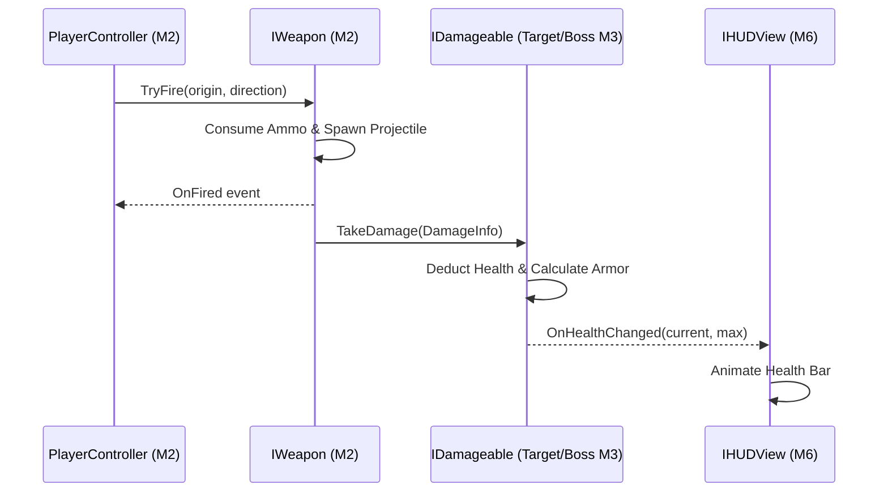
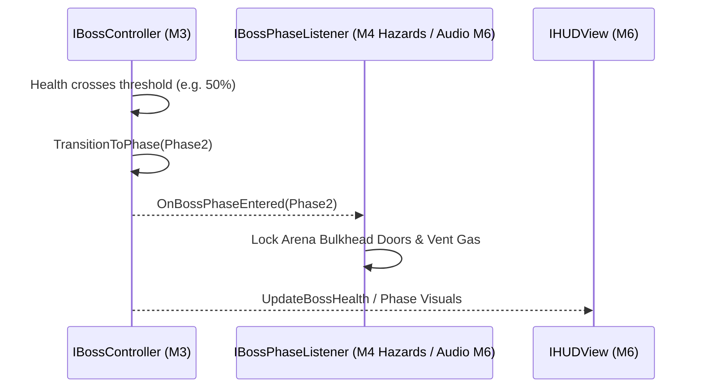
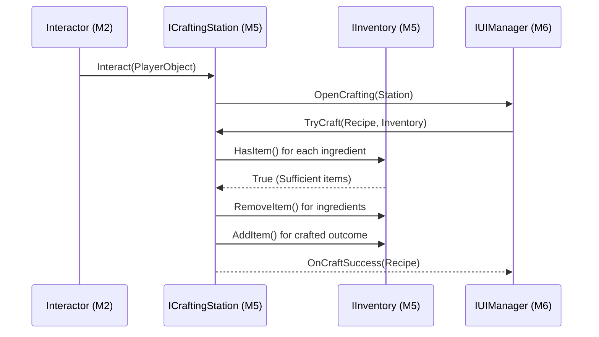

# OBLIVION'S EDGE — Team Architectural Contracts & Interface Specifications

**Document Version:** 1.1.0  
**Author:** Member 1 (Technical Lead)  
**Target Engine:** Unity 6 (6000.6.5f1) (2D Sci-Fi Survival Horror)  
**Repository:** [https://github.com/skandakn/Oblivion-s-Edge](https://github.com/skandakn/Oblivion-s-Edge)  

---

## 1. Executive Architecture Summary

*Oblivion's Edge* is a 2D top-down sci-fi survival horror game developed by a collaborative team of engineers. To prevent merge conflicts, circular dependencies, and blocking bottlenecks, this project strictly adheres to **Interface-First Design** and **Decoupled Event-Driven Communication**.

### Core Tenets:
1. **Interface Segregation**: Subsystems communicate strictly via published C# interfaces located in `Assets/Scripts/`. Concrete classes must never depend directly on unfinished peer implementations.
2. **Event-Driven Observation**: State changes (damage taken, phase transition, puzzle resolved, item crafted) broadcast via C# events (`System.Action<T>`). Systems subscribe to events rather than polling across frames.
3. **Immutability of Baseline Contracts**: The contracts in `OblivionsEdge.*` represent the shared foundational agreement established by Member 1. Any modification to shared interfaces requires technical lead sign-off.
4. **Unity .meta File Integrity**: Every folder and asset in `Assets/` is tracked with its corresponding `.meta` file. Never delete, rename, or regenerate `.meta` files manually.

---

## 2. C# Namespaces, Structure & Conventions

### 2.1 Namespace Hierarchy
All code must reside within the root namespace `OblivionsEdge` and its domain-specific sub-namespaces:

| Namespace | Domain Description | Assigned Owner |
|---|---|---|
| `OblivionsEdge.Core` | Game lifecycle, constants, global damage, interaction contracts, bootstrapper | Member 1 (Tech Lead) |
| `OblivionsEdge.Player` | Kinematic movement, stamina, oxygen, sanity, input mapping, health | Member 2 |
| `OblivionsEdge.Weapons` | Ballistic/energy weapons, firing logic, projectiles, reloading | Member 3 |
| `OblivionsEdge.Boss` | Boss AI, phase orchestration, enrage timers, armor & weakpoints | Member 4 & Member 5 |
| `OblivionsEdge.Puzzles` | The Edge (Laser), The Handle (Rotation), The Core (Gravity alignment) | Member 6, Member 7 & Member 8 |
| `OblivionsEdge.Inventory` | Item definitions, stack calculations, encumbrance, story pickups | Member 9 |
| `OblivionsEdge.Crafting` | Workbenches, resource recipes, station interaction pipeline | Member 9 & Member 10 |
| `OblivionsEdge.DeathStorm` | Legendary weapon synthesis countdown, 3-stage mini-game, axe combat | Member 10 |
| `OblivionsEdge.UI` | HUD vital bars, ammo counters, modal panels, prompt overlays, telemetry | Member 12 |

### 2.2 Naming Conventions
- **Interfaces**: Prefixed with `I` in PascalCase (e.g., `IDamageable`, `IPlayerController`, `IWeapon`).
- **Classes / Structs / Enums**: PascalCase (e.g., `DamageInfo`, `CraftingRecipe`, `BossPhase`).
- **Methods / Properties**: PascalCase (e.g., `TakeDamage()`, `CurrentHealth`).
- **Private / Protected Fields**: Prefixed with underscore in camelCase (e.g., `_currentStamina`, `_fireRate`).
- **Constants / Static Readonly**: PascalCase or uppercase snake (e.g., `GameConstants.TagPlayer`).
- **Events**: Prefixed with `On` (e.g., `OnHealthChanged`, `OnPhaseChanged`, `OnItemAdded`).

---

## 3. Tags, Layers & 2D Physics Matrix

All tags and layers are defined in `ProjectSettings/TagManager.asset` and mirrored in `GameConstants.cs`.

### 3.1 Tags
- `Player` — Controllable player avatar.
- `Enemy` — Standard hostile entities.
- `Boss` — Encounter bosses.
- `Weapon` — In-world or equipped weaponry.
- `Projectile` — Active ballistic/energy bullets.
- `Interactable` — Triggerable objects (terminals, doors, loot crates).
- `ItemPickup` — World item pickups.
- `SaveStation` — Secure recovery terminals.
- `Hazard` — Environmental hazards (radiation, depressurization, electric arc).

### 3.2 Layers
| Layer Index | Layer Name | Collision / Raycast Purpose |
|---|---|---|
| 0 | `Default` | General geometry |
| 1 | `TransparentFX` | Particles, glows, volumetric fog |
| 2 | `Ignore Raycast` | UI colliders, background visuals |
| 4 | `Water` | Fluid mechanics |
| 5 | `UI` | Canvas UI screen space elements |
| 6 | `Player` | Player character collider & hurtbox |
| 7 | `Enemy` | Hostile creature colliders & hurtboxes |
| 8 | `Environment` | Solid bulkheads, walls, doors, collision barriers |
| 9 | `Interactable` | Raycastable/Trigger zones for player interaction |
| 10 | `PlayerProjectile` | Bullets/lasers fired by player (hits Enemy, Environment, Boss) |
| 11 | `EnemyProjectile` | Spits/plasma fired by enemies (hits Player, Environment) |
| 12 | `ItemPickup` | Trigger colliders for world items |
| 13 | `TriggerZone` | Cutscenes, puzzle entry zones, audio triggers |

### 3.3 2D Physics Collision Matrix Rules
- `PlayerProjectile` **collides with**: `Enemy`, `Boss`, `Environment`. (Ignored by `Player`, `PlayerProjectile`, `ItemPickup`).
- `EnemyProjectile` **collides with**: `Player`, `Environment`. (Ignored by `Enemy`, `EnemyProjectile`, `ItemPickup`).
- `Player` **collides with**: `Environment`, `Enemy`, `Interactable` (trigger only), `ItemPickup` (trigger only).

### 3.4 2D Sorting Layers Hierarchy (Back to Front)
1. `Background` (Z-depth parallax, deep station hulls)
2. `Environment` (Floors, walls, bulkheads, consoles)
3. `Items` (Pickups, debris, scrap)
4. `Characters` (Enemies, Boss, Player)
5. `Projectiles` (Tracers, muzzle flashes, plasma bolts)
6. `Foreground` (Overhead pipes, ceiling shadows, lighting occluders)
7. `UI` (HUD screens, crosshairs, modal dialogues)

---

## 4. Contract Specifications by Subsystem

### 4.1 Player System Contract (`OblivionsEdge.Player`)
**Assigned Owner:** Member 2  
**Key Interfaces:**
- `IPlayerController`: Exposes locomotion inputs, aiming vectors, sprinting, crouching, and control lockdowns.
- `IPlayerStats`: Extends `IDamageable` with survival metrics: Stamina, Sanity, and Oxygen.

```csharp
// Locomotion contract
public interface IPlayerController
{
    Vector2 MoveDirection { get; }
    Vector2 AimDirection { get; }
    bool IsGrounded { get; }
    bool IsMoving { get; }
    bool IsSprinting { get; }
    bool IsCrouching { get; }
    void SetMoveInput(Vector2 direction);
    void SetAimTarget(Vector2 worldPosition);
    void SetSprint(bool isSprinting);
    void SetCrouch(bool isCrouching);
    void TriggerDash();
    void DisableControls();
    void EnableControls();
    event Action<Vector2> OnMoved;
    event Action OnDashed;
}

// Survival metrics contract
public interface IPlayerStats : IDamageable
{
    float CurrentStamina { get; }
    float MaxStamina { get; }
    float CurrentSanity { get; }
    float MaxSanity { get; }
    float CurrentOxygen { get; }
    float MaxOxygen { get; }
    bool ConsumeStamina(float amount);
    void RestoreStamina(float amount);
    void ModifySanity(float delta);
    void ModifyOxygen(float delta);
    event Action<float, float> OnStaminaChanged;
    event Action<float, float> OnSanityChanged;
    event Action<float, float> OnOxygenChanged;
    event Action OnSanityDepleted;
    event Action OnOxygenDepleted;
}

// Animal Character & Companion Contract (OblivionsEdge.Player.AnimalCharacter)
// Enlarged quadruped combat beast (scale 1.65x) with IDamageable, autonomous AI, and manual possession [T].
public interface IAnimalCharacter : IDamageable
{
    string CharacterName { get; }
    bool IsDirectlyControlled { get; }
    Transform TargetPlayer { get; set; }
}
```

---

### 4.2 Weapons & Combat Contract (`OblivionsEdge.Weapons` & `OblivionsEdge.Core`)
**Assigned Owner:** Member 2  
**Key Interfaces & Types:**
- `IDamageable`: Universal recipient for damage events.
- `DamageInfo`: Struct carrying damage payload (Amount, Type, Source, HitPoint, KnockbackForce).
- `IWeapon`: Weapon state machine (firing, ammo capacity, reloading, fire rate).
- `IWeaponHandler`: Player/NPC bridge for swapping and triggering equipped weapons.

```csharp
public struct DamageInfo
{
    public float Amount;
    public DamageType Type; // Physical, Energy, Thermal, Toxic, EMP
    public GameObject Source;
    public Vector2 HitPoint;
    public Vector2 HitDirection;
    public float KnockbackForce;
    public bool IsCritical;
}

public interface IWeapon
{
    string WeaponId { get; }
    string DisplayName { get; }
    WeaponType Type { get; }
    FireMode Mode { get; }
    int CurrentAmmo { get; }
    int MagazineCapacity { get; }
    bool CanFire { get; }
    bool IsReloading { get; }
    bool TryFire(Vector2 origin, Vector2 direction);
    bool StartReload();
    void CancelReload();
    void AddAmmo(int amount);
    event Action OnFired;
    event Action<int, int> OnAmmoChanged;
    event Action OnReloadStarted;
    event Action OnReloadFinished;
    event Action OnDryFire;
}
```

---

### 4.3 Boss & AI Contract (`OblivionsEdge.Boss`)
**Assigned Owner:** Member 3  
**Key Interfaces & Types:**
- `IBossController`: Orchestrates multi-phase encounters, damage gating, stuns, and enrage states. Extends `IDamageable`.
- `IBossPhaseListener`: Enables environmental triggers (doors locking, poison gas vents, dynamic BGM) to synchronize with boss phases.

```csharp
public enum BossPhase
{
    Dormant, Intro, Phase1, Phase2, Phase3,
    VulnerableStun, Enraged, Defeated
}

public interface IBossController : IDamageable
{
    string BossId { get; }
    string DisplayName { get; }
    BossPhase CurrentPhase { get; }
    bool IsInvulnerable { get; }
    float EnrageTimerRemaining { get; }
    void StartBossEncounter();
    void TransitionToPhase(BossPhase newPhase);
    void SetInvulnerable(bool invulnerable);
    void TriggerStun(float durationSeconds);
    void RegisterPhaseListener(IBossPhaseListener listener);
    void UnregisterPhaseListener(IBossPhaseListener listener);
    event Action<BossPhase> OnPhaseChanged;
    event Action OnBossEnraged;
    event Action OnBossStunned;
    event Action OnBossDefeated;
}
```

---

### 4.4 Puzzle & Environment Contract (`OblivionsEdge.Puzzles`)
**Assigned Owner:** Member 4  
**Key Interfaces & Types:**
- `IPuzzleElement`: Individual switch, fuse node, dial, or circuit board extending `IInteractable`.
- `IPuzzleController`: Manages puzzle validation, logic state evaluation, solve conditions, and triggers.

```csharp
public enum PuzzleState { Unsolved, InProgress, Solved, Failed, Disabled }
public enum PuzzleType { PowerGridReroute, KeycardBiometricAccess, SequenceMemoryTerminal, PressurePlateLock, FrequencyTuner, AirlockPressureDecontamination }

public interface IPuzzleElement : IInteractable
{
    string ElementId { get; }
    bool IsActive { get; }
    int Value { get; }
    void SetActive(bool active);
    void SetValue(int value);
    void ResetElement();
    event Action<IPuzzleElement> OnElementStateChanged;
}

public interface IPuzzleController
{
    string PuzzleId { get; }
    PuzzleType Type { get; }
    PuzzleState State { get; }
    bool IsSolved { get; }
    bool EvaluateCondition();
    void ForceSolve();
    void ResetPuzzle();
    event Action<PuzzleState> OnPuzzleStateChanged;
    event Action OnPuzzleSolved;
    event Action OnPuzzleFailed;
}
```

---

### 4.5 Inventory & Items Contract (`OblivionsEdge.Inventory`)
**Assigned Owner:** Member 5  
**Key Interfaces & Types:**
- `ItemData`: Struct holding immutable archetype metadata (Id, Name, MaxStack, Weight, Category).
- `IItem`: Runtime instance representing quantity and stack manipulation.
- `IInventory`: Container enforcing slot capacity and weight encumbrance limits.

```csharp
public interface IInventory
{
    int SlotCapacity { get; }
    float CurrentWeight { get; }
    float MaxWeight { get; }
    bool IsFull { get; }
    bool AddItem(IItem item);
    bool AddItemById(string itemId, int quantity);
    bool RemoveItem(string itemId, int quantity);
    bool HasItem(string itemId, int quantity = 1);
    int GetItemCount(string itemId);
    IItem GetItemAtSlot(int slotIndex);
    event Action<int, IItem> OnSlotChanged;
    event Action<IItem> OnItemAdded;
    event Action<string, int> OnItemRemoved;
    event Action<float, float> OnWeightChanged;
}
```

---

### 4.6 Crafting Contract (`OblivionsEdge.Crafting`)
**Assigned Owner:** Member 5  
**Key Interfaces & Types:**
- `CraftingRecipe`: Recipe definition containing ingredient costs and output items.
- `ICraftingStation`: In-world fabrication workbench extending `IInteractable` that queries and mutates player inventory.

```csharp
public interface ICraftingStation : IInteractable
{
    string StationId { get; }
    string StationName { get; }
    IReadOnlyList<CraftingRecipe> AvailableRecipes { get; }
    bool CanCraft(CraftingRecipe recipe, IInventory sourceInventory);
    bool TryCraft(CraftingRecipe recipe, IInventory sourceInventory);
    event Action<CraftingRecipe> OnCraftSuccess;
    event Action<CraftingRecipe, string> OnCraftFailed;
}
```

---

### 4.7 UI & HUD Telemetry Contract (`OblivionsEdge.UI`)
**Assigned Owner:** Member 6  
**Key Interfaces & Types:**
- `IHUDView`: Direct rendering layer for health, stamina, sanity, oxygen, ammo counters, and interaction prompts.
- `IUIManager`: Screen coordinator managing modal panels (Inventory, Crafting, Pause, Terminals) and game pause requests.

```csharp
public interface IHUDView
{
    void UpdateHealth(float current, float max);
    void UpdateStamina(float current, float max);
    void UpdateSanity(float current, float max);
    void UpdateOxygen(float current, float max);
    void UpdateAmmo(int currentMagazine, int totalReserve);
    void UpdateEquippedWeapon(string weaponDisplayName);
    void ShowInteractionPrompt(string promptText);
    void HideInteractionPrompt();
    void ShowBossHealthBar(string bossName, float currentHealth, float maxHealth);
    void UpdateBossHealth(float currentHealth, float maxHealth);
    void HideBossHealthBar();
}

public interface IUIManager
{
    IHUDView HUD { get; }
    UIPanelType ActivePanel { get; }
    bool IsAnyModalOpen { get; }
    void OpenInventory();
    void CloseInventory();
    void OpenCrafting(ICraftingStation station);
    void CloseCrafting();
    void OpenPauseMenu();
    void ClosePauseMenu();
    void ShowNotification(string message, float durationSeconds = 3f);
    void CloseAllModals();
    event Action<UIPanelType> OnPanelOpened;
    event Action<UIPanelType> OnPanelClosed;
}
```

---

### 4.8 DeathStorm Legendary Weapon & Crafting Ritual Contract (`OblivionsEdge.DeathStorm`)
**Assigned Owner:** Member 10  
**Key Interfaces & Types:**
- `IDeathStormCrafting`: 3-stage assembly mini-game (Core alignment, Edge sync, Energy stabilization) with strict 60-second countdown and enrage penalty.
- `AxeCombat`: Directional heavy melee strike targeting boss exposed weak points for final execution.

```csharp
public enum CraftingStage
{
    Idle,
    CoreAlignment,
    EdgeSync,
    EnergyStabilise,
    Complete,
    TimedOut
}

public interface IDeathStormCrafting
{
    CraftingStage CurrentStage { get; }
    float CountdownRemaining { get; }
    float CountdownTotal { get; }
    bool HasDeathStorm { get; }
    bool IsCountdownRunning { get; }
    string CurrentInstruction { get; }
    bool SubmitAnswer(int answer);
    event Action<float, float> OnTimerTick;
    event Action<CraftingStage> OnStageChanged;
    event Action<float> OnWrongAnswer;
    event Action OnCraftingSuccess;
    event Action<bool> OnCountdownExpired;
}
```

---

## 5. Cross-System Integration Flows

### Flow 1: Combat & Damage Resolution


### Flow 2: Boss Phase Transition & Arena Hazards


### Flow 3: Resource Crafting Pipeline


---

## 6. Git Workflow, Branching & Integration Protocol

### 6.1 Team Ownership Map
- **Member 1 (Tech Lead & Unity Foundation)**: Architecture anchor, Core interfaces (`IDamageable`, `IInteractable`, `GameConstants`, `GameManager`), `RuntimeBootstrapper.cs`, Unity 6 config, git hygiene & PR merges (`setup/unity-foundation`, Base: `main`).
- **Member 2 (Player Movement & Survival)**: Kinematic locomotion, jump buffering, coyote time, dash evasion, player health & vitals (`feature/player-controller`).
- **Member 3 (Gun Combat & Ballistics)**: Pulse pistol, 360-degree aiming, magazine ammo tracking, reloading, projectile physics (`feature/gun-combat`).
- **Member 4 (Alien Boss AI & Hunting Behavior)**: Finite-state machine (Awakening, Hunt, Telegraph, Charge, Recover, Exposed), pathing (`feature/alien-ai`).
- **Member 5 (Boss Combat, Armor & Core Release)**: Dual-layer bio-armor, armor breaking, core release trigger, weak-point collider (`feature/boss-combat`).
- **Member 6 (The Edge: Laser Reflection Puzzle)**: 2D optics reflection puzzle, rotatable mirror nodes, laser beam receiver (`feature/edge-puzzle`).
- **Member 7 (The Handle: Geometric Rotation Puzzle)**: Concentric ring alignment puzzle, angular step rotation, cipher solution (`feature/handle-puzzle`).
- **Member 8 (The Core: Gravity Alignment Puzzle)**: Four-directional gravity/magnetic alignment puzzle, boss-gated unlock (`feature/core-puzzle`).
- **Member 9 (Inventory, Interactions & Story Objects)**: Inventory container, artifact tracking, contextual interaction query, lore pickups (`feature/inventory-interactions`).
- **Member 10 (DeathStorm Crafting & Final Strike)**: Legendary weapon 3-stage synthesis ritual, 60s countdown timer, enrage penalty, execution axe strike (`feature/deathstorm`).
- **Member 11 (Level Design, Lighting & Atmosphere)**: 4-sector research vessel layout, survival horror 2D lighting, environmental bulkheads (`feature/level-atmosphere`).
- **Member 12 (UI, QA & Judge Demonstration)**: In-game HUD overlay, vitals bars, ammo readout, component tracker, QA test validation, demo scripts (`feature/ui-qa`).
- **Member 13 (Localhost Interactive Simulation & WebGL)**: Standalone 2D browser simulation (`Tools/LocalPreview/index.html`), single-click launcher, WebGL deployment (`feature/localhost-preview-webgl`).

### 6.2 Branch Naming Standard
All development occurs in dedicated feature branches branching from `main`:
- `feature/<member-id>-<brief-description>` (e.g., `feature/m2-player-controller`, `feature/m3-boss-phase-ai`)
- `fix/<member-id>-<brief-description>` (e.g., `fix/m5-inventory-stack-overflow`)
- `setup/<description>` (e.g., `setup/unity-foundation`)

### 6.3 Golden Collaboration Rules
1. **Pull Before Branching**: Always run `git pull origin main` before creating new branches.
2. **Never Touch Another Member's Concrete Files Without Direct Coordination**: Write your own classes implementing their published interface.
3. **Commit Every `.meta` File**: Always inspect `git status` to ensure `.meta` files accompany every new asset or script.
4. **Never Force Push**: Rebasing and force pushes on `main` are strictly forbidden.
